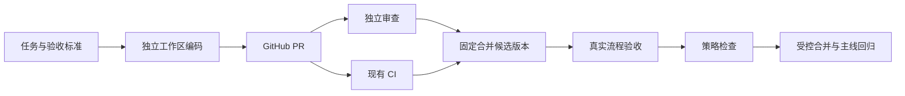

# Scion

**Rust 编写的 Agent 研发交付编排项目：连接 GitHub/Git、独立 PR 审查、现有 CI、真实功能验收和按策略合并。**

状态：`0.0.1 / foundation`。当前提供设计文档、Cargo workspace 和离线流程判断 CLI；完整的 Agent → GitHub PR → CI → 验收 → 自动合并闭环尚未实现。



GitHub/Git 是代码、分支和 PR 的权威来源。Scion 记录任务、版本、检查和证据，在条件不满足时给出明确阻塞原因。

## 当前可以运行

需要 Rust 1.98.0，仓库的 `rust-toolchain.toml` 固定工具链。

```sh
cargo build --locked --workspace
cargo run --locked -p scion-cli -- evaluate examples/ready.json
cargo run --locked -p scion-cli -- evaluate examples/blocked.json
scripts/check.sh
```

`ready.json` 和 `blocked.json` 都是虚构输入。CLI 只判断输入是否满足规则，输出始终包含 `mode: dry_run`、`evidence_verified: false` 和 `merge_performed: false`，不代表外部 PR 通过验收。退出码：`0` 输入条件满足，`3` 被规则阻塞，`2` 参数、文件或 JSON 错误。

目前检查：三类必要证据、非 PASS 结果、重复/缺失证据、候选版本不一致、审查者与编码者相同、空证据入口、默认关闭自动合并和所需人工确认。

## 模块

| 模块 | 状态 | 职责 |
| --- | --- | --- |
| `scion-core` | 基础实现 | 候选版本、证据、状态和决策数据结构 |
| `scion-orchestrator` | 基础实现 | 离线流程判断，返回逐项阻塞原因 |
| `scion-cli` | 基础实现 | JSON 输入/输出、错误与退出码 |
| GitHub 适配器、任务存储 | 规划中 | 读取权威 PR/CI 状态、事件去重、断点恢复 |
| Agent 执行器、审查执行器 | 规划中 | 隔离运行、预算与取消、独立身份审查 |
| 验收执行器、合并控制器 | 规划中 | 真实用例与制品、最后核验、受控合并 |

设计与实现顺序见 [架构](docs/architecture.md)、[首版路线](docs/roadmap.md)、[验收标准](docs/acceptance.md)。

## 与参考项目的关系

本项目参考 [CarterT27/scion](https://github.com/CarterT27/scion) 的 Rust workspace 和模块分层思路。参考项目实现独立版本控制系统；本项目首版围绕 GitHub/Git 交付流程建设，保留现有仓库和 CI。

本仓库与 Anthropic、CarterT27 没有隶属关系。参考来源、固定版本和技术取舍见 [参考说明](docs/references.md)。许可证：[Apache-2.0](LICENSE)。
Rust foundation for agent coding, PR review, CI, real acceptance and controlled merging on GitHub/Git.
